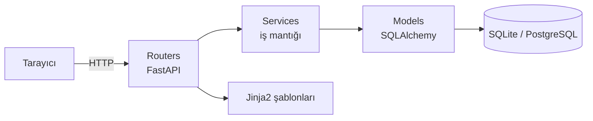
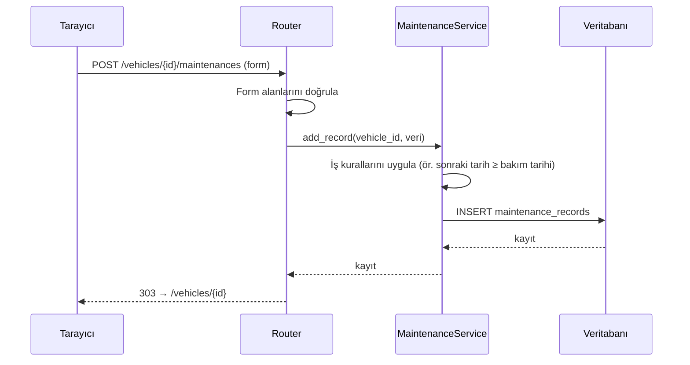
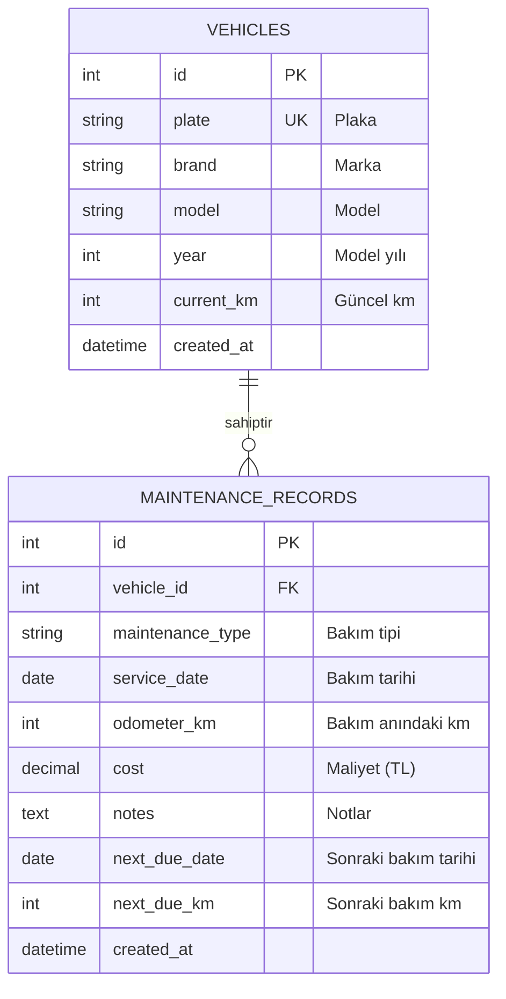
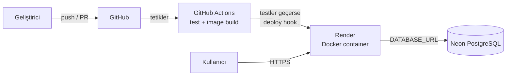

# Mimari ve Veri Modeli

Bu doküman Araç Bakım Takip Sistemi'nin katmanlı mimarisini, veri modelini ve HTTP uç noktalarını açıklar.
Fonksiyonel gereksinimler için bkz. [README](../README.md#fonksiyonel-gereksinimler).

## 1. Genel Bakış

Uygulama tek bir FastAPI servisidir. Arayüz sunucu tarafında Jinja2 şablonlarıyla üretilir; ayrı bir
frontend uygulaması yoktur. Veritabanına SQLAlchemy üzerinden erişilir, böylece aynı kod yerelde ve CI'da
SQLite, bulutta PostgreSQL (Neon) ile çalışır.

## 2. Katmanlar

| Katman | Konum | Sorumluluk | Sorumlu olmadığı |
|---|---|---|---|
| Routers | `app/routers/` | HTTP isteğini almak, form verisini doğrulamak, servisi çağırmak, şablonu render etmek | İş kuralı |
| Services | `app/services/` | İş kuralları: araç/bakım işlemleri, hatırlatma hesaplaması | HTTP ve HTML |
| Models | `app/models/` | Tablo tanımları ve ilişkiler | İş kuralı |
| Altyapı | `app/config.py`, `app/database.py` | Ortam değişkenlerinden ayar okuma, veritabanı bağlantısı ve oturum | — |

**Kural:** İş mantığı yalnızca `services/` katmanında bulunur. Böylece birim testlerinin çoğu HTTP
katmanına ihtiyaç duymadan servis fonksiyonlarını doğrudan test eder.

### İstek akışı (örnek: bakım kaydı ekleme)

## 3. Veri Modeli

### `vehicles`

| Alan | Tip | Kısıt | Açıklama |
|---|---|---|---|
| `id` | integer | PK | |
| `plate` | varchar(20) | not null, unique | Plaka |
| `brand` | varchar(50) | not null | Marka |
| `model` | varchar(50) | not null | Model |
| `year` | integer | nullable | Model yılı |
| `current_km` | integer | not null, varsayılan 0 | Güncel kilometre |
| `created_at` | timestamp | not null, veritabanı saatiyle | Kayıt zamanı |

### `maintenance_records`

| Alan | Tip | Kısıt | Açıklama |
|---|---|---|---|
| `id` | integer | PK | |
| `vehicle_id` | integer | FK → `vehicles.id`, cascade delete, index | Ait olduğu araç |
| `maintenance_type` | varchar(50) | not null | Yağ değişimi, lastik, fren vb. |
| `service_date` | date | not null | Bakımın yapıldığı tarih |
| `odometer_km` | integer | nullable | Bakım anındaki kilometre |
| `cost` | numeric(10,2) | nullable | Maliyet (TL) |
| `notes` | text | nullable | Serbest not |
| `next_due_date` | date | nullable | Bir sonraki bakım tarihi |
| `next_due_km` | integer | nullable | Bir sonraki bakım kilometresi |
| `created_at` | timestamp | not null, veritabanı saatiyle | Kayıt zamanı |

**Silme davranışı:** Bir araç silindiğinde bakım kayıtları hem ORM ilişkisi (`cascade="all, delete-orphan"`)
hem de yabancı anahtar (`ON DELETE CASCADE`) ile silinir.

**Tablo oluşturma:** Tablolar uygulama başlangıcında `Base.metadata.create_all` ile oluşturulur. Proje
kapsamında şema göç (migration) aracı kullanılmamaktadır.

## 4. Hatırlatma Kuralları (F4)

Hatırlatma hesabı `app/services/` içinde, veritabanından bağımsız bir fonksiyon olarak yapılır.

1. Her araç ve bakım tipi için yalnızca **en son** (`service_date` en büyük) kayıt dikkate alınır.
2. **Geciken:** `next_due_date < bugün` **veya** `current_km ≥ next_due_km`.
3. **Yaklaşan:** geciken değil ve `bugün ≤ next_due_date ≤ bugün + 30 gün`.
4. `next_due_date` ve `next_due_km` alanlarının ikisi de boşsa kayıt hatırlatmaya girmez.

## 5. HTTP Uç Noktaları

| Metot | Yol | İşlev | Fonksiyon |
|---|---|---|---|
| GET | `/` | Dashboard: yaklaşan ve geciken bakımlar | F4 |
| GET | `/vehicles` | Araç listesi | F1 |
| POST | `/vehicles` | Araç ekle | F1 |
| GET | `/vehicles/{id}` | Araç detayı + bakım geçmişi (sıralama, filtre) | F1, F3 |
| POST | `/vehicles/{id}/edit` | Araç güncelle | F1 |
| POST | `/vehicles/{id}/delete` | Araç sil | F1 |
| POST | `/vehicles/{id}/maintenances` | Bakım kaydı ekle | F2 |
| GET | `/reminders` | Hatırlatma listesi | F4 |
| GET | `/health` | Sağlık kontrolü (JSON) | İzleme |
| GET | `/docs` | OpenAPI dokümantasyonu (FastAPI otomatik) | — |

HTML formları yalnızca GET ve POST gönderebildiği için güncelleme ve silme işlemleri `POST .../edit` ve
`POST .../delete` yollarıyla yapılır. Başarılı POST işlemlerinden sonra 303 yönlendirmesi döner
(Post/Redirect/Get).

## 6. Yapılandırma

Tüm ayarlar ortam değişkenlerinden okunur (`app/config.py`). Yerelde `.env` dosyası kullanılabilir;
şablonu `.env.example` içindedir.

| Değişken | Varsayılan | Açıklama |
|---|---|---|
| `DATABASE_URL` | `sqlite:///./vehicle_maintenance.db` | Veritabanı bağlantı adresi. `postgres://` adresleri otomatik olarak `postgresql+psycopg://` sürücüsüne çevrilir. |
| `LOG_LEVEL` | `INFO` | Log seviyesi |
| `APP_ENV` | `development` | Ortam adı |

Bağlantı adresleri ve diğer sırlar repoda tutulmaz; bulutta GitHub Secrets ve Render ortam değişkenlerinde
saklanır.

## 7. Dağıtım Görünümü (planlanan)

CI (Hafta 5), Docker (Hafta 6) ve bulut dağıtımı (Hafta 7) tamamlandıkça bu bölüm güncellenecektir.
